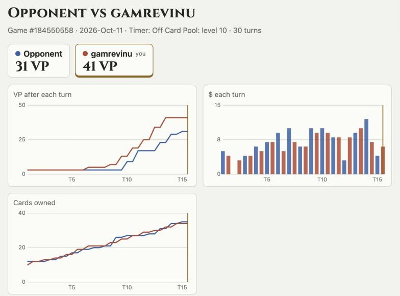
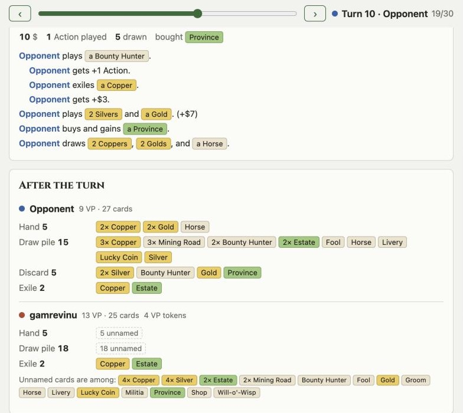
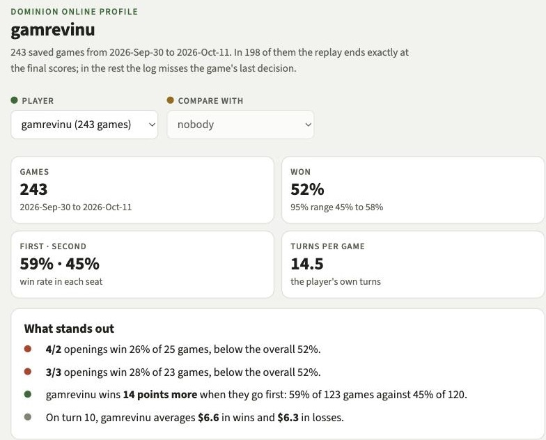
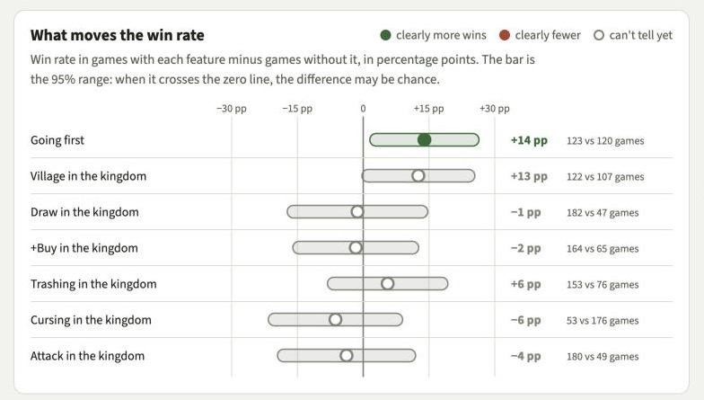
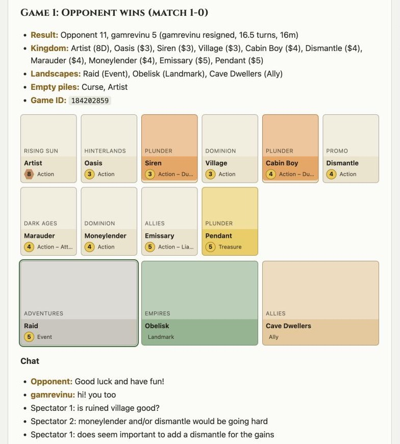

# Scrying Pool

**Look back into your finished [Dominion Online](https://dominion.games) games.**

<p>


</p>

Scrying Pool is a small app that runs on your own computer. Give it the number of a game you played, and it replays the game turn by turn. Save a few dozen games, and it shows what tends to win and lose games for you.

## Replay any game

Score, money and deck size for both players, turn by turn:



Drag the slider to any turn to see what happened and where every card is: hand, draw pile, discard pile, mats. Cards the log doesn't name are counted, with a list of what they can be.



## See what wins your games

Your win rate, the clearest patterns in plain words, and what changes your results: going first, a village in the kingdom, +Buy, trashing and so on. Green or red means the difference is clear, grey means it may be chance.





The page also shows your form over the last 30 games, $ per turn in wins and losses, when you buy your first Province, and your best and hardest kingdom cards. You can put a second player next to you to compare.

## Notes from a match chat

Paste the chat of a finished match and get readable notes: one section per game with its kingdom, result and that game's chat.



## Try it

You need a dominion.games account and [Go](https://go.dev/dl/) 1.26 or newer. Then, in a terminal:

```bash
go install github.com/yourconscience/scrying-pool@latest
```

```bash
scry web
```

Open http://127.0.0.1:8765. The first time, the app needs one bookmark from your dominion.games tab; [docs/capture.md](docs/capture.md) walks you through it.

## Good to know

- Your games stay on your computer. Nothing is sent anywhere unless you publish a page or turn on DomBot lookups.
- Finished games only: the dominion.games Terms of Service ban tools that help during a game.
- Card art belongs to Rio Grande Games. The images come from [KingdomCreator](https://github.com/blakevanlan/KingdomCreator) and aren't stored in this repo.
- Work in progress. Not affiliated with Shuffle iT, Rio Grande Games, DomBot or the Dominion League.

## More

- [Loading games](docs/capture.md): one game, hundreds at once, overnight runs.
- [Match notes](docs/match-notes.md): chat notes and DomBot results.
- [How it works](docs/internals.md): how logs are read, how the numbers are made, the CLI, where data lives.
- [SPEC.md](SPEC.md): the plan and the log of decisions.
